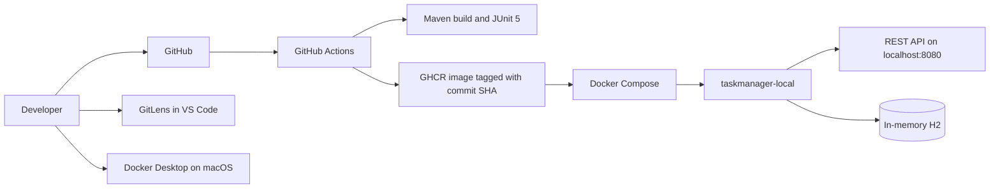

# Architecture

The application uses controller, service, repository, entity, and exception-handler layers. GitHub-hosted Actions runners build and publish images; they do not control the developer's Mac. The local deployment script runs Compose on Docker Desktop and verifies the health endpoint.
