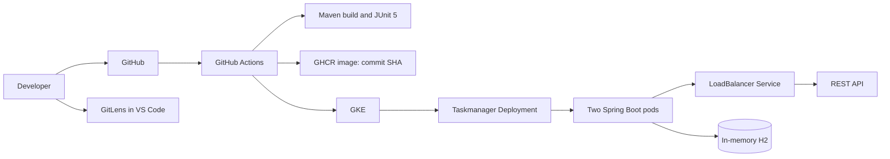

# Architecture

The application follows controller, service, repository, and entity layers. Spring Boot validation and a global exception handler provide consistent API errors. H2 is intentionally in-memory for a stateless classroom demonstration; a persistent database should be introduced for production.

The workflow has a strict dependency chain:

`build-and-test -> publish-image -> deploy-to-gke -> verify-deployment`

Pull requests run only the first job. Publishing and deployment run only for `main` pushes or an explicit manual workflow dispatch.
